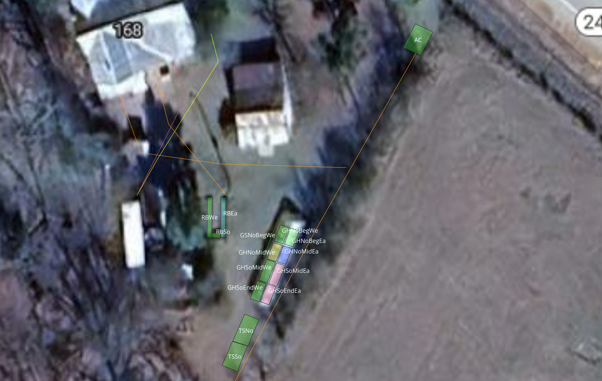

# Crops
## By Type

### Plants
#### Roots & Tubers
Garlic
Beets
Carrots
Onions
Turmeric

#### Fruiting (Require Pollination)
Tomatoes (Sungold)
Tomatoes (Beefsteak)
Tomatoes (Cherry)
Tomatoes (Jumbo Cherry)

Cucumbers
Eggplant
Peppers (Sweet Bell)
Peppers (Hungarian Wax)
Peppers (Jalapeño)
Watermelons
Cantaloupe
Okra
Strawberries
Zucchini

Sweet Corn

Squash (Spaghetti)
Squash (Summer)
Squash (Acorn)
Squash (Butternut)

Beans (Scarlet Runner)
Beans (Cowpeas)


#### Leafy Greens (Heavy Feeders)
Collards
Kale
Cabbage
Broccoli
Chard
Bok Choy
Mustard Greens

#### Leafy Greens (Light Feeders)
Lettuce
Spinach

#### Herbs
Chives (Garlic)
Mint (Mountain)
Mint (Peppermint)
Mint (Shiso)
Sage
Rosemary
Basil

### Bushes
Raspberry
Elderberry
Blueberry
Blackberry

### Trees
Figs (Turkey)
Plum (Japanese)
Pear (Asian)
Pear (Pineapple)
Pear (Kiefer)
Plum (Chickasaw)
Lemon
Banana

```custom-frames
frame: Plant-Abbv
```

## By Plot
Subplot Naming Key: 
`{AB}` = Abbreviation, derived from its familiar name / title, All Caps
`{Di}` = Cardinal Directions as two letters, Capitalized, eg No / Ea / So / We
`{Pos}` = Position, standing at the northern most end (the end we typically approach from) in three letters, Capitalizer, eg Beg / Mid / End = Beginning / Middle / End
Name Legend will appear as follows to indicate how the name for that plot is characterized. For example:`{AB}{Di}{Pos}{Di}`
All dimensions in feet, with the first value running North to South and the second value running East to West.

### Three Sisters
#### Subplots
Legend: `{AB}{Di}`

| Subplot | Dimensions (ft) |
|:---|:---|
| TSSo | 16.5 x 10 |
| TSNo | 16.5 x 10 |

##### Corn
Sweet Corn

##### Squash
Spaghetti Squash
Summer Squash
Acorn Squash
Butternut Squash

##### Legumes
Scarlet Runner Beans
Cowpeas

### Greenhouse
#### Subplots
Legend: `{AB}{Di}{Pos}{Di}`

| Subplot   | Dimensions (ft) | Precipitation (in) | SOR (in/Hr) | Crop Codes                       |
| :-------- | :-------------- | :----------------- | ----------- | -------------------------------- |
| GHSoEndEa | 11 x 5.5        |                    |             |                                  |
| GHSoEndWe | 11 x 5.5        |                    |             |                                  |
| GHSoMidEa | 13 x 5.5        |                    |             |                                  |
| GHSoMidWe | 13 x 5.5        | 3/8                | 12/8        | CBBG / CL                        |
| GHNoMidEa | 10 x 5.5        |                    |             |                                  |
| GHNoMidWe | 10 x 5.5        | .62                | 2.48        | CBBG / KL, TURMR, TM, BEANS / SR |
| GHNoBegEa | 10 x 5.5        |                    |             |                                  |
| GHNoBegWe | 10 x 5.5        | 1.25               | 5           | CBBG, CBBG / BC                  |

##### Roots & Tubers
Garlic
Beets
Carrots
Onions
Sweet Potato

##### Leafy Greens (Heavy Feeders)
Collards
Kale
Cabbage
Broccoli
Chard
Bok Choy
Mustard Greens

##### Leafy Greens (Light Feeders)
Lettuce
Spinach

### Greenhouse Side
#### Subplots
Legend: `{AB}{Di}{Pos}{Di}`

| Subplot | Dimensions (ft) |
|:---|:---|
| GSNoBegWe | 20 x 1 |

Watermelons

### Raised Beds
#### Subplots
Legend: `{AB}{Di}`

| Subplot | Dimensions (ft) |
| :------ | :-------------- |
| RBEa    | 23 x 3          |
| RBSo    | 3 x 5           |
| RBWe    | 23 x 3          |
|         |                 |
#### Fruiting
Tomatoes
Cucumbers
Eggplant
Peppers
Watermelon 


### Acidic
#### Subplots
Legend: `{AB}`

| Subplot | Dimensions (ft) |
| :------ | :-------------- |
| AC      | 15 x 11         |
#### Bushes
Raspberry
Elderberry

# Plan
## Irrigation
### GH 
System Hydraulic Analysis & Critical Discrepancy

Your catch-can calibration identified a massive pressure and output gradient across your greenhouse mist line:

⚬ GHSoMidWe: 1.50\text{ in/hr} (0.375\text{ in} in 15 min)
⚬ GHNoMidWe: 2.48\text{ in/hr} (0.62\text{ in} in 15 min) — 1.65\times wetter than South Mid
⚬ GHNoBegWe: 5.00\text{ in/hr} (1.25\text{ in} in 15 min) — 3.33\times wetter than South Mid

Because misting systems operate on a single line/valve, setting one blanket runtime will dramatically overwater the North beginning or severely underwater the South end.

Monthly Environmental Baseline & Water Demands

From your dataset and seasonal operational states:

⚬ Fully Enclosed (December – March): Low solar radiation, daytime temperatures average 7.5°C–16.3°C (45°F–61°F), and VPD drops to 0.25–0.50 kPa. Trapped humidity slows water loss. Crop demand is low: 0.35 to 0.70 inches/week.
⚬ Transition & Ventilation Opening (April – May): Mean daytime temperatures reach 19.7°C–22.3°C (67°F–72°F). Opening the door and rear wall introduces air velocity, increasing evaporative pull. Crop demand rises to 1.00 to 1.25 inches/week.
⚬ Peak Summer Ventilated (June – August): Maximum daytime temperatures average 25°C–28.5°C (77°F–83°F, with peak highs reaching 36.4°C / 97.5°F). Even with 75–85% RH, high transpiration and natural airflow push crop demand to 1.40 to 1.60 inches/week.
⚬ Cooling Fall Transition (September – November): Days shorten, mean temperatures drop from 23.1°C to 13.4°C, and demand tapers from 1.20 down to 0.55 inches/week.

Master Watering Schedule (Month-by-Month)

The table below provides:

1. Target Crop Need (in/week) for your greenhouse canopy.
2. Frequency (Days per Week) to prevent waterlogging during cold months and drought stress during hot months.
3. Required Runtime per Session (Minutes) for the specific subplots you tested.

| Month | Greenhouse State | Target Water (in/week) | Watering Frequency | Run Time per Event | Pulse Delivery Schedule | Timing Window |
| :--- | :--- | :--- | :--- | :--- | :--- | :--- |
| **Jan** | Enclosed | 0.35 in | **1 day/wk** (e.g., Wed) | **10.5 min** | Single cycle (10.5 min) | 9:00 AM |
| **Feb** | Enclosed | 0.45 in | **1 day/wk** (e.g., Wed) | **13.5 min** | Single cycle (13.5 min) | 9:00 AM |
| **Mar** | Enclosed | 0.70 in | **2 days/wk** (Tue, Sat) | **10.5 min** | Single cycle (10.5 min) | 8:30 AM |
| **Apr** | Ventilated | 1.00 in | **3 days/wk** (Mon, Wed, Fri) | **10 min** | 2 pulses: 5 min on / 15 min rest / 5 min on | 7:30 AM & 7:50 AM |
| **May** | Ventilated | 1.25 in | **4 days/wk** (Mon, Wed, Fri, Sun) | **9.5 min** | 2 pulses: 5 min on / 15 min rest / 4.5 min on | 7:30 AM & 7:50 AM |
| **Jun** | Ventilated | 1.50 in | **5 days/wk** (Mon–Fri) | **9 min** | 2 pulses: 4.5 min on / 15 min rest / 4.5 min on | 7:00 AM & 7:20 AM |
| **Jul** | Ventilated | 1.60 in | **5 days/wk** (Mon–Fri) | **9.5 min** | 2 pulses: 5 min on / 15 min rest / 4.5 min on | 7:00 AM & 7:20 AM |
| **Aug** | Ventilated | 1.40 in | **4 days/wk** (Mon, Wed, Fri, Sun) | **10.5 min** | 2 pulses: 5.5 min on / 15 min rest / 5 min on | 7:00 AM & 7:20 AM |
| **Sep** | Ventilated | 1.20 in | **4 days/wk** (Mon, Wed, Fri, Sun) | **9 min** | 2 pulses: 4.5 min on / 15 min rest / 4.5 min on | 7:30 AM & 7:50 AM |
| **Oct** | Ventilated | 0.85 in | **3 days/wk** (Mon, Wed, Fri) | **8.5 min** | Single cycle (8.5 min) | 8:00 AM |
| **Nov** | Transition | 0.55 in | **2 days/wk** (Tue, Sat) | **8 min** | Single cycle (8 min) | 8:30 AM |
| **Dec** | Enclosed | 0.35 in | **1 day/wk** (e.g., Wed) | **10.5 min** | Single cycle (10.5 min) | 9:00 AM |


Managing the Hardware Realities

If all subplots are hooked to a single zone valve, running the system for 12–14 minutes (to satisfy the slower GHSoMidWe bed) will dump over 1 inch of water per event onto GHNoBegWe, drowning brassica root systems and causing disease.

To equalize this without replacing the irrigation system:

1. Re-Nozzle or Add In-Line Flow Controls (Minimal Expense):
  ⚬ Swap the misting heads over GHNoBegWe to a lower-orifice nozzle (e.g., 0.5–1.0 GPH mist nozzle), or insert a small $1 plastic micro-valve right above the dropper lines feeding that section.
  ⚬ This immediately balances line pressure toward the South End (GHSoMidWe), making application uniform without replumbing.
2. Crop Placement Strategy (Leveraging the Discrepancy):
  ⚬ Keep heavy water consumers in GHNoBegWe: Scarlet Runner Beans (BEANS/SR), large leafy collards (CBBG/CL), or turmeric (TURMR) thrive in higher moisture and heat transpiration.
  ⚬ Keep rot-sensitive root crops in GHSoMidWe: Carrots, garlic, and onions will avoid bulb rot and mold in the naturally drier, lower-application zone.
3. The Morning Pulse Protocol:
  ⚬ During April through September, split each watering event into two pulses separated by 20 minutes (e.g., at 7:30 AM and 7:55 AM). This lets the mist penetrate the dense organic soil instead of pooling on top, and leaves plenty of morning daylight for greenhouse air to dry leaf surfaces before noon.

### Orchard
### 1. System Output & Calibration Analysis

From your on-site measurement:

- **Output Measured:** 32\text{ oz} (0.25\text{ gal}) collected in 15\text{ minutes}.
    
- **System Flow Rate:**
    
    $$\text{Flow Rate} = \frac{0.25\text{ gal}}{15 / 60\text{ hr}} = 1.0\text{ Gallon Per Hour (GPH) per stake}$$
    

#### Delivery Depth & Physics of the 14-Inch Drip Stake

A 14-inch perforated subterranean stake bypasses surface evaporation entirely:

- **Application Efficiency (E_i):** Exceptionally high (**90\% - 95\%**), compared to 60\% - 75\% for surface sprinklers.
    
- **Soil Profile Risk (Sandy Loam over Subsoil Clay):** Because your native clay starts 24 inches down, injecting water 14 inches deep places the discharge bulb just 10 inches above the impermeable clay pan. During rainy periods or over-irrigation, water accumulates rapidly at the clay boundary, creating a temporary perched water table that can suffocate roots.
    

### 2. Crop Compatibility on a Single Serial Line

Because the blueberries, plums, and the lemon tree are plumbed together in series, one operating schedule governs all three. Their rooting structures and water appetites differ sharply:

|Crop|Rooting Architecture & Depth|Dormancy Behavior|Vulnerabilities on Shared Line|
|---|---|---|---|
|**Lemon Tree** (Young, 4' tall, 5' canopy diameter)|Moderate depth (12–24 in), broad evergreen canopy|Evergreen; enters cold quiescence below 55°F, but maintains basal transpiration|Cold, waterlogged roots in winter will induce root rot and eliminate cold hardiness.|
|**Blueberries** (_Vaccinium virgatum_ / _ashei_)|Shallow (top 12–18 in), fine fibrous roots, no root hairs|Deciduous; minimal water use Nov–Feb|Highly vulnerable to _Phytophthora cinnamomi_ if the 14-inch zone stays saturated.|
|**Plums** (_Prunus salicina_)|Deep branching taproot (24–36 in into subsoil)|Fully deciduous; true dormancy Nov–Feb|Zero water uptake in winter; supplemental winter watering causes crown rot.|

> **Key Rule for the Shared Line:** In humid Zone 8b, **never irrigate on a rigid calendar during the winter or after significant rainfall**. The deciduous plums and blueberries consume virtually zero water in winter; rainfall alone in Southeast Georgia (3.0 - 4.5\text{ inches/month}) exceeds dormant orchard requirements. Supplemental irrigation is strictly an **active-season demand (April – October)** and during extended winter dry spells (14+ days without rain).

### 3. Engineering the Schedule: The Mathematical Model

Water demand is calculated using the standard FAO-56 Penman-Monteith crop water equation converted to volumetric tree canopy requirements:

$$\text{Gallons Per Day (GPD)} = \frac{\text{Canopy Area} \times ET_0 \times K_c \times 0.623}{E_i}$$

#### Parameters Applied:

1. **Canopy Area (A):** For a 5-foot canopy diameter (radius r = 2.5\text{ ft}), typical of a 4-foot young citrus:
    
    $$A = \pi \times (2.5\text{ ft})^2 \approx 19.63\text{ sq ft}$$
    
    _(Note: If the 5' measurement refers to branch radius rather than diameter, canopy area becomes 78.5\text{ sq ft}, which scales water volumes up by a factor of 4. For a 4-foot-tall tree, a 5-foot diameter is standard)._
    
2. **Reference Evapotranspiration (ET_0):** Derived from your climate dataset and Southeast Georgia regional baseline (ranging from 0.05\text{ in/day} in December/January up to 0.21\text{ in/day} in June/July).
    
3. **Crop Coefficient (K_c):**
    
    - _Citrus (Lemon):_ 0.55 (winter) to 0.65 (summer).
        
    - _Blueberry:_ 0.20 (dormant) to 1.00 (fruit sizing in June).
        
    - _Plum:_ 0.20 (dormant) to 1.05 (active leaf/fruit May–July).
        
4. **Net Irrigation Requirement:** In an outdoor orchard, supplemental run time is only required when **ET_c > \text{Effective Rainfall}**. When ambient weekly rain is \ge 0.5 - 1.0\text{ inch}, the system remains off.
    

### 4. Master Orchard Watering Schedule


| Plant & Dimensions                           | Canopy Footprint (\pi r^2) | Peak Summer Need (Gal / Wk) | Recommended Total Flow Rate (GPH) | Recommended Hardware Setup                                                                                                                      |
| -------------------------------------------- | -------------------------- | --------------------------- | --------------------------------- | ----------------------------------------------------------------------------------------------------------------------------------------------- |
| Young Blueberry (2' drip line, 1' height)    | 3.1 sq ft                  | ~3.0 gal                    | 0.5 GPH                           | 1 single stake with a 0.5 GPH emitter.                                                                                                          |
| Young Lemon Tree (5' drip line, 4' height)   | 19.6 sq ft                 | ~12.5 gal                   | 2.0 GPH                           | 1 stake with a 2.0 GPH emitter (or two 1.0 GPH stakes on opposite sides).                                                                       |
| Mature Blueberry (5' drip line, 5' height)   | 19.6 sq ft                 | ~19.5 gal                   | 3.0 to 4.0 GPH                    | 2 stakes (each 1.5 to 2.0 GPH) placed on opposite sides of the root crown. (Higher demand than citrus due to heavy berry fill & shallow roots). |
| Mature Plum Tree (12' drip line, 12' height) | 113.1 sq ft                | ~100 – 115 gal              | 16.0 to 20.0 GPH total            | 4 stakes spaced evenly around the 12' drip line, each fitted with a 4.0 to 5.0 GPH emitter (or a multi-stake micro-ring).                       |

Because your orchard plants share a **single serial irrigation line**, they all run for the exact same duration whenever the timer activates.

Since your controller caps runtimes at **1 hour per cycle**, managing this system requires addressing two realities:

1. **Canopy Area Dictates Flow:** Water needs scale with canopy footprint (\text{Area} = \pi r^2). A 12 ft mature plum tree has nearly **6 times the surface area** of the 5 ft lemon tree and **36 times the area** of the 2 ft young blueberry.
    
2. **The "Single Emitter" Bottleneck on Large Trees:** In sandy loam soil, a single 14-inch deep drip stake only creates a localized wetted bulb about 1.5 to 2 feet wide. A 12-foot tree cannot be watered by a single 1 GPH stake—doing so creates a localized soggy anaerobic pocket while leaving 90% of the root zone dry.
    

### 1. Water Demand & GPH Recommendations by Plant

To align all four crops on the same line, **their emitter flow rates (GPH) must match their peak summer water demand ratios** (calculated for peak June/July in Zone 8b):

|Plant & Dimensions|Canopy Footprint (\pi r^2)|Peak Summer Need (Gal / Wk)|Recommended Total Flow Rate (GPH)|Recommended Hardware Setup|
|---|---|---|---|---|
|**Young Blueberry**  <br>(2' drip line, 1' height)|**3.1 sq ft**|**~3.0 gal**|**0.5 GPH**|**1 single stake** with a 0.5 GPH emitter.|
|**Young Lemon Tree**  <br>(5' drip line, 4' height)|**19.6 sq ft**|**~12.5 gal**|**2.0 GPH**|**1 stake** with a 2.0 GPH emitter (or two 1.0 GPH stakes on opposite sides).|
|**Mature Blueberry**  <br>(5' drip line, 5' height)|**19.6 sq ft**|**~19.5 gal**|**3.0 to 4.0 GPH**|**2 stakes** (each 1.5 to 2.0 GPH) placed on opposite sides of the root crown. _(Higher demand than citrus due to heavy berry fill & shallow roots)._|
|**Mature Plum Tree**  <br>(12' drip line, 12' height)|**113.1 sq ft**|**~100 – 115 gal**|**16.0 to 20.0 GPH total**|**4 stakes** spaced evenly around the 12' drip line, each fitted with a **4.0 to 5.0 GPH emitter** (or a multi-stake micro-ring).|

### 2. Strategy: Swap Emitters vs. Stacking Cycles

Both strategies have distinct roles in solving the 1-hour controller limit:

#### Strategy A: Swap Emitters & Add Delivery Points (Mandatory for Balancing)

- **Why you must adjust flow rates:** If you leave all plants with 1.0 GPH heads and merely add more 1-hour cycles to satisfy the plum tree, you would have to run the line for 20+ hours a week. That would dump 20+ gallons onto your 2 ft blueberry (drowning it with root rot) and overwater the lemon tree.
    
- **Action:** Calibrate each plant's GPH according to the table above. For the plum tree and mature blueberry, split the flow across multiple stakes around the drip line rather than blasting 16 GPH into a single point.
    

#### Strategy B: Stacking 1-Hour Cycles (For Total Weekly Volume)

- To deliver the weekly water volume during peak summer without running single multi-hour blocks, use the controller's **multiple start times (stacking cycles)**.
    
- **The "Soak and Rest" Technique:** Instead of running 2 to 3 continuous hours (which can pool water above the 2-foot clay boundary), program **two 1-hour cycles spaced 60 to 90 minutes apart** on scheduled watering days (e.g., Cycle 1 at 6:30 AM, Cycle 2 at 8:00 AM).
    
- This allows sandy loam to absorb the first inch of moisture deep into the subsoil before the second cycle applies the rest.
    

### 3. Unified 1-Hour Cycle Schedule Across the Year

With the plants' hardware balanced to the GPH ratings above, all plants can be watered together using 1-hour timer blocks:

| Season / Month                     | Weekly Target Run Time | Timer Programming (1-Hour Cycles)                                                              | Total Water Delivered (Plum / Lemon / Mat. Berry / Yng. Berry)                                           |
| ---------------------------------- | ---------------------- | ---------------------------------------------------------------------------------------------- | -------------------------------------------------------------------------------------------------------- |
| **Winter**  <br>(Dec – Feb)        | **1 hr every 14 days** | **1 cycle (1 hr)** on the 1st and 15th of the month. _(Skip if rolling 48-hr rain \ge 0.25")._ | Plum: ~18 gal  <br>Lemon: 2 gal  <br>Mat. Berry: ~3.5 gal  <br>Yng. Berry: 0.5 gal                       |
| **Spring Transition**  <br>(March) | **2 hrs / week**       | **1 cycle (1 hr)**, 2 days/wk (e.g., Tue & Sat).                                               | Plum: ~36 gal/wk  <br>Lemon: 4 gal/wk  <br>Mat. Berry: ~7 gal/wk  <br>Yng. Berry: 1 gal/wk               |
| **Early Warm**  <br>(April)        | **4 hrs / week**       | **2 cycles of 1 hr** on 2 days/wk (e.g., Tue & Fri: 7:00 AM & 8:30 AM).                        | Plum: ~72 gal/wk  <br>Lemon: 8 gal/wk  <br>Mat. Berry: ~14 gal/wk  <br>Yng. Berry: 2 gal/wk              |
| **Peak Summer**  <br>(May – July)  | **6 hrs / week**       | **2 cycles of 1 hr** on 3 days/wk (e.g., Mon, Wed, Fri: 6:30 AM & 8:00 AM).                    | Plum: ~108 gal/wk  <br>Lemon: 12 gal/wk  <br>Mat. Berry: ~21 gal/wk  <br>Yng. Berry: 3 gal/wk            |
| **Late Summer**  <br>(Aug – Sept)  | **4 to 5 hrs / week**  | **2 cycles of 1 hr** on 2 days/wk (plus optional 1 hr on Sunday during hot spells).            | Plum: ~72–90 gal/wk  <br>Lemon: 8–10 gal/wk  <br>Mat. Berry: ~14–17 gal/wk  <br>Yng. Berry: 2–2.5 gal/wk |
| **Fall Taper**  <br>(Oct – Nov)    | **1 to 2 hrs / week**  | **1 cycle (1 hr)**, 1 to 2 days/wk depending on leaf drop.                                     | Plum: ~18–36 gal/wk  <br>Lemon: 2–4 gal/wk  <br>Mat. Berry: ~3.5–7 gal/wk  <br>Yng. Berry: 0.5–1 gal/wk  |

### Implementation Checklist

1. **Change the Lemon Tree Emitter:** Swap the current 1.0 GPH head to a **2.0 GPH pressure-compensating (PC) emitter** (or add a second 1.0 GPH stake on the opposite side of the 5 ft canopy).
    
2. **Downsize the Small Blueberry:** Drop the 2 ft bush to a **0.5 GPH emitter** so it receives roughly 1/4 the volume of the lemon.
    
3. **Expand Plum Distribution:** Tap into the serial lateral line around the plum tree to feed **four 4.0 GPH stakes** placed at 90-degree intervals beneath its 12 ft branch line. This ensures the tree receives the necessary ~18 gallons per hour of runtime across its broad root system.

| Month | Target Schedule | Duration per Event | Water per Event | Programmable Rain Cutoff (48-hr Rolling) |
| :--- | :--- | :--- | :--- | :--- |
| **Jan** | Every 14 days | 2 hr 30 min | 2.5 gal | Skip if 48-hr rain $\ge$ **0.25 in** |
| **Feb** | Every 14 days | 3 hr 00 min | 3.0 gal | Skip if 48-hr rain $\ge$ **0.25 in** |
| **Mar** | 1 day / week | 3 hr 00 min | 3.0 gal | Skip if 48-hr rain $\ge$ **0.25 in** |
| **Apr** | 2 days / week | 2 hr 30 min | 2.5 gal | Skip if 48-hr rain $\ge$ **0.25 in** |
| **May** | 2 days / week | 3 hr 00 min | 3.0 gal | Skip if 48-hr rain $\ge$ **0.30 in** |
| **Jun** | 3 days / week | 2 hr 15 min | 2.25 gal | Skip if 48-hr rain $\ge$ **0.25 in** |
| **Jul** | 3 days / week | 2 hr 15 min | 2.25 gal | Skip if 48-hr rain $\ge$ **0.25 in** |
| **Aug** | 2 days / week | 2 hr 45 min | 2.75 gal | Skip if 48-hr rain $\ge$ **0.30 in** |
| **Sep** | 2 days / week | 2 hr 15 min | 2.25 gal | Skip if 48-hr rain $\ge$ **0.25 in** |
| **Oct** | 1 day / week | 3 hr 00 min | 3.0 gal | Skip if 48-hr rain $\ge$ **0.25 in** |
| **Nov** | Every 14 days | 2 hr 00 min | 2.0 gal | Skip if 48-hr rain $\ge$ **0.20 in** |
| **Dec** | Every 14 days | 2 hr 30 min | 2.5 gal | Skip if 48-hr rain $\ge$ **0.25 in** |


### 5. Critical Zone 8b Lemon Winter Survival Directives

Because the lemon tree is an experimental planting in Zone 8b (where winter lows in your dataset dropped to **-8.0°C / 17.5°F** in January):

1. **Hydration Before Freezes:** Dry citrus roots freeze far faster than moist roots because water releases latent heat as it cools. If an advective Arctic freeze (<25^\circ\text{F}) is predicted, **run the stake line for 1 to 2 hours the morning before the freeze hits**. Do not let roots sit in waterlogged soil during sustained cold; simply ensure the root zone is moist.
    
2. **Subterranean Soil Warming:** Your 14-inch stakes deposit water deep where winter soil temperatures stay warmer than surface air. However, cold winter rains pooled above the clay layer can cause root rot. If you observe water standing in the stake tubes 24 hours after a storm, shut the line off completely until the top 6 inches of soil are dry to the touch.
    
3. **Plum and Blueberry Safeguard:** If the lemon tree requires winter moisture during an unusually dry winter stretch, running the line for 2 hours will not harm the dormant plums and blueberries provided the interval between events is **at least 10 to 14 days**. Their roots need cold-season soil aeration to prevent fungal infection.

## JADAM

JADAM is an ultra-low-cost, self-reliant organic farming system developed in South Korea by chemist and agriculturist Youngsang Cho. The name is an abbreviation of the Korean phrase _Jayeon-ul Damun Saramdeul_, which translates to "people who resemble nature." In the context of permaculture, JADAM serves as a powerful practical toolkit that perfectly aligns with permaculture's core design principles—specifically *"Produce No Waste,"* *"Use & Value Renewable Resources,"* and *"Obtain a Yield."* [1](https://www.youtube.com/watch?v=570b5aUQNSM&t=235), [2](https://permies.com/t/72060/JADAM-method-farming), [3](https://www.harmonia.institute/what-is-jadam-organic-farming-a-complete-guide-to-ultra-low-cost-regenerative-agriculture/)

While it evolved out of Korean Natural Farming (KNF), JADAM intentionally strips away complex, expensive, and commercialized inputs (like brown sugar or specialized imports). Instead, it teaches growers how to be entirely self-sufficient by creating potent biological amendments using nothing but local wild resources, crop residues, and water. [1](https://worldpermacultureassociation.com/liquid-fertilizers-how-to-make-them/), [2](https://www.youtube.com/watch?v=570b5aUQNSM&t=235), [3](https://www.harmonia.institute/what-is-jadam-organic-farming-a-complete-guide-to-ultra-low-cost-regenerative-agriculture/)

### Core Concept: The SESE Principles

JADAM operates under a framework known as **SESE**: **S**imple, **E**asy, **S**cientific, and **E**ffective. Its goal is to return technological sovereignty to the farmer so that anyone can manage thousands of acres—or a backyard food forest—for next to no money. [1](https://en.jadam.kr/com/com-1.html), [2](https://www.youtube.com/watch?v=570b5aUQNSM&t=235)

### The 4 Major JADAM Inputs Used in Permaculture

Permaculturists frequently integrate JADAM recipes into their soil-building and pest-management systems because they are decentralized and utilize local "waste" streams:

- **JADAM Microorganism Solution (JMS):** Considered the backbone of the system. Instead of buying commercial bio-inoculants, you harvest a handful of rich leaf mold soil from a nearby healthy forest. You ferment these indigenous microorganisms (IMOs) in a bucket of water using boiled potatoes (as a carbohydrate food source) and sea salt. It breeds billions of native microbes to drench into your soil, rapidly improving soil structure and root depth. [1](https://www.youtube.com/watch?v=6-CfEKPo6xY&t=53), [2](https://www.youtube.com/shorts/3a2_t2F76xE), [3](https://www.homegrowncoop.org/solutions/how-to-start-jadam-organic-farming-low-cost-steps-for-sustainable-agriculture/)
- **JADAM Liquid Fertilizer (JLF):** A "like-for-like" nutrient cycle. You put wild grasses, crop residues, weeds, or food waste into a barrel, fill it with water, and let it undergo a continuous anaerobic fermentation. This creates a completely free, highly bio-available liquid fertilizer that mirrors how nutrients recycle on a forest floor. [1](https://www.youtube.com/watch?v=MDzvIN9AEH4&t=481), [2](https://www.youtube.com/watch?v=570b5aUQNSM&t=235), [3](https://worldpermacultureassociation.com/liquid-fertilizers-how-to-make-them/), [4](https://www.facebook.com/groups/permaculturenz/posts/2521228108146368/)
- **JADAM Wetting Agent (JWA):** A natural, eco-friendly liquid surfactant made from canola/castor oil and potassium hydroxide. It breaks the surface tension of water, allowing natural foliar sprays to smoothly coat and stick to plant leaves without washing away. [1](https://www.youtube.com/watch?v=_63xa8bEUzM&t=144), [2](https://kimchime.com.au/blog-home/organic-farming-jadam/?srsltid=AYCX9vLWizFbRSW6gMn4KH7Ea4syqYZFPZMR0jvOUgPVFgevG0Evs5jD), [3](https://www.harmonia.institute/what-is-jadam-organic-farming-a-complete-guide-to-ultra-low-cost-regenerative-agriculture/)
- **JADAM Sulfur (JS) & Herbal Solutions (JHS):** Used for natural pest and disease control. By combining JWA with melted raw sulfur or boiled highly-potent local herbs (like garlic or wild mint), growers create powerful fungicides and pesticides that comply with strict organic regulations. [1](https://www.youtube.com/watch?v=5EY6lOfICbw&t=148), [2](https://en.jadam.kr/com/com-1.html), [3](https://www.youtube.com/watch?v=_63xa8bEUzM&t=144), [4](https://www.youtube.com/watch?v=6-CfEKPo6xY&t=53), [5](https://www.harmonia.institute/what-is-jadam-organic-farming-a-complete-guide-to-ultra-low-cost-regenerative-agriculture/)

### How JADAM Complements Permaculture Philosophy

- **Radical Self-Reliance:** Permaculture emphasizes localizing supply chains. JADAM ensures you never have to purchase commercial organic fertilizers, bagged compost, or bottled pesticides again. [1](https://www.linkedin.com/posts/jonathanwells369_jadam-stands-for-jayonul-damun-saramdeul-activity-7332799302659883008-Znw-), [2](https://en.jadam.kr/com/com-1.html)
- **Accepting Anaerobic Processes:** While traditional organic farming and permaculture often over-index on highly aerated compost teas, JADAM values anaerobic putrefaction. It recognizes that anaerobic microbes are natural, powerful decomposers crucial to balanced living ecosystems. [1](https://www.facebook.com/groups/permaculturenz/posts/2521228108146368/), [2](https://www.youtube.com/watch?v=MDzvIN9AEH4&t=481)
- **Open-Source Knowledge:** True to permaculture's third ethic of "Fair Share," JADAM’s formulations are explicitly unpatented and open-source, intended to be freely modified and shared globally. [1](https://permies.com/t/72060/JADAM-method-farming), [2](https://worldpermacultureassociation.com/liquid-fertilizers-how-to-make-them/)

If you are looking to scale up a permaculture design or food forest without spending a fortune on external store-bought inputs, JADAM is often the missing operational manual that makes it financially viable. [1](https://www.youtube.com/watch?v=YQnoWWw6k0Y), [2](https://www.harmonia.institute/what-is-jadam-organic-farming-a-complete-guide-to-ultra-low-cost-regenerative-agriculture/)
### Farm Profile & Site Diagnostic

- **Location & Climate:** USDA Zone 8b, Southeast Georgia (below the Fall Line). Hot, humid, extended growing season; mild winters with erratic warm snaps; proximity to coastal/marsh humidity.
    
- **Native Soil Profile:** 24 inches of sandy loam over dense subsoil clay. High drainage and aeration in the topsoil with high leaching susceptibility (especially for borates, nitrates, and potassium); dense clay subsoil acts as an impermeable chemical and root barrier that can perch water during excessive rainfall.
    
- **Compost Infrastructure:** Five 3 ft × 5 ft × 4 ft enclosed bays processing horse stable muckings (manure, sawdust, wood chips) plus winter hay. High-carbon, fungal-dominant feedstock potential; produces substantial bulk organic matter.
    - **Locally Sourced Mulches & Plants:** Abundant local pine straw; wild/foraged stands of comfrey and stinging nettle; native forest leaf mold (IMO microbial source); unrefined sea salt / coastal mineral access.
    
- **Hydrology & Irrigation Infrastructure:**
    
    - _Greenhouse:_ Automated overhead misting (seasonal intervals: daily in summer, alternate days in fall, every 4 days in winter). High humidity, gentle water delivery.
        
    - _Three Sisters:_ Open plot with subsurface drip lines (4–6 inches deep, 2ft apart) embedded within buried woody mulch bands beneath the crop rows.
        
    - _Raised Beds:_ Dual-hydrology system in RBEa and RBWe (the longer beds) featuring a subterranean graywater wicking basin below 24 inches of topsoil, paired with natural rainfall.
        
    - _Acidic Plot:_ Ambient precipitation supported by dedicated 10-minute daily drip stakes placed 6–12 inches from cane/shrub crowns.
        
- **Operational Mandate:** Permaculture design principles with JADAM self-reliance additions:
    - Minimize Waste Products
    - Use & Value Renewable Resources (closed-loop reliance on farm-sourced biology, dynamic accumulators, and wild microorganisms)
    - Obtain a Yield
    - Low-carbon footprint
    - SESE Framework: Simple, Easy, Scientific, and Effective
    - Zero-to-minimal store-bought inputs: replace recurring commercial fertilizers, inoculants, and pest sprays with farm-made JADAM preparations (JMS, JLF, JWA, JS)
    - Minimize plastic for non-infrastructure purposes to the extent possible
    

### Critical Operational Adjustments to Your Infrastructure

Before addressing the plots, your site details require four crucial technical interventions:

#### 1. Graywater Salinity & Boron Dynamics in Raised Beds

A subterranean wicking basin charged with household graywater creates two distinct chemical risks in a raised bed:

- **Sodium & Surfactants:** Household soaps, laundry wash, and cleaners often carry sodium salts and sulfates. In a bottom-up wicking system, water travels upward via capillary action, evaporates at the surface, and leaves salts behind. Over time, electrical conductivity (EC) spikes in the top 6 inches, causing salt burn on salt-sensitive Solanaceae (especially peppers and eggplants).
    
- **The Boron Trap:** Some detergents contain sodium borate or perborate. While boron is needed in trace amounts, a buildup will cause severe margin necrosis and plant death.
    
- **Intervention:** Ensure all household detergents are strictly potassium-based, plant-safe, and boron-free. Flush the beds with heavy top-watering once each spring to wash accumulated wick-salts back down past the primary root zones.
    

#### 2. Greenhouse Misting: Salt Accumulation & Disease Vector

- **Watering Frequency Calibration:** Winter misting every 4 days is often too wet for dormant greenhouse soil in humid coastal Georgia, yet daily summer misting risks constant leaf wetness. 

TODO: Determine frequency of misting for various crops based on the stage and seasonal conditions.

#### 3. Woody Mulch Nitrogen Immobilization in Three Sisters

Buried wood chips/sawdust (4–6 inches deep) next to subsurface drip lines will drive intense fungal and bacterial decomposition right at your irrigation zone. Microorganisms require a Carbon-to-Nitrogen (C:N) ratio of roughly 24:1. High-carbon wood materials (C:N 100:1 to 400:1) will cause soil microbes to pull all free plant-available nitrogen (NO_3^- and NH_4^+) out of the surrounding soil solution.

- While the beans fix their own nitrogen once nodulated, corn is an extreme nitrogen feeder and will rapidly stunt, yellow, and fail if its nodal roots hit a nitrogen-starved, wood-dominated subsurface layer.
    
- **Intervention:** Inoculate this subsurface wood layer directly with **JADAM Microorganism Solution (JMS)** blended with high-nitrogen **JADAM Liquid Fertilizer (JLF)** (made from fresh grass clippings, stinging nettle, or farm urine). The native microbes rapidly digest the wood without robbing available nitrogen from the corn roots.
    

#### 4. The 10-Minute Drip on Acidic Plot

A daily 10-minute drip run wets only a tiny bulb of sandy loam directly under the emitter, discouraging root expansion into the wider bed, while keeping the surface root crowns constantly damp (inviting _Phytophthora_ root rot in raspberries).

- **Intervention:** Shift from 10 minutes daily to **30–45 minutes once or twice a week**. This forces water 12–18 inches deep, matching the native 2-foot topsoil profile and training the berries to send deep, resilient anchor roots down to the moisture-retentive clay transition zone.
    

### Closed-Loop Biological Strategy: Replacing Store-Bought Inputs with JADAM

Rather than relying on ongoing purchases of commercial organic inputs or bulky mineral sacks, JADAM utilizes locally harvested wild inputs and simple water fermentations:

1. **Microbial Diversity (Replaces Commercial Inoculants & Mycorrhizae):**
   - **JMS (JADAM Microorganism Solution):** Harvest a handful of rich indigenous leaf mold soil from a healthy local forest. Ferment in water with boiled potatoes (starches) and a pinch of unrefined sea salt for 24–72 hours until vigorous foam peaks. Apply as a soil drench to wake up biological nutrient cycling across all beds.

2. **Full-Spectrum Trace Minerals (Replaces Basalt Rock Dust & Solubor / Borax):**
   - **Natural Sea Salt in JMS:** Unrefined natural sea salt provides full-spectrum ocean minerals (magnesium, zinc, iron, boron, manganese, selenium) in natural biological ratios. Delivered regularly via JMS drenching, it supplies all required trace elements for pennies.

3. **Complete N-P-K & Calcium (Replaces Soft Rock Phosphate, Bone Meal & Chemical Feeds):**
   - **JLF (JADAM Liquid Fertilizer):** Anaerobic barrel ferments of site-harvested comfrey, stinging nettle, dynamic weeds, charred bone, and eggshell scrap. Water-soluble, zero-cost, and immediately available to plant roots without synthetic processing.

4. **Natural Disease & Pest Control (Replaces Commercial Fungicides & Insecticides):**
   - **JWA (JADAM Wetting Agent):** Biodegradable natural surfactant made from canola oil, KOH, and soft water.
   - **JS (JADAM Sulfur) & JHS (Herbal Solutions):** Homemade melted raw sulfur and boiled herb extracts (wild mint, garlic, horsetail). Mixed with JWA, these control powdery mildew, downy mildew, and soft-bodied pests without breaking organic standards.

*(Note: If bulk agricultural sacks of basalt dust or gypsum are already on hand, incorporate them into the 5-bay compost piles as a one-time mineral charge, but rely on JADAM liquid ferments for ongoing seasonal nutrition).*


### Adapted Plan by Plot

#### 1. Three Sisters Plot (Sandy Loam over Clay, Subsurface Woody Drip)

- **The Dynamic:** Sweet Corn, Squash varieties, Scarlet Runner Beans, Cowpeas.
    
- **Nutrient Adjustments:**
    
    - The sandy loam leaches potassium quickly; your buried wood risks locking up nitrogen. Cowpeas will adapt quickly to the heat, but Runner Beans often drop blossoms when Georgia 8b summer temperatures exceed 85°F–90°F. (Favor cowpeas in the hottest months).
        
- **Soil & Mulch Actions:**
    
    - **Compost Charge & JMS Inoculation:** Work finished horse manure compost into planting hills. Drench planting hills at sowing with **JMS** to rapidly colonize native microbes along the root zone and kickstart decomposition of the buried wood.
        
    - **Trace Minerals & Potassium (Replaces Basalt Dust Purchases):** Drench with sea-salt-charged JMS and a 1:30 dilution of **Comfrey JLF** to supply zinc, boron, and bioavailable potassium for corn stalk rigidity and squash fruiting.
        
    - **Mulch Layer:** Surface-dress around the corn and squash with **pine straw**. Pine straw moderates high summer soil temperatures in Zone 8b, suppresses weed flushes, and does not rob surface nitrogen like raw wood shavings do.
        

#### 2. Greenhouse (Dark, 3-Year Matured Soil, Transitioning from Mist)

- **The Dynamic:** Garlic, Beets, Carrots, Onions | Brassicas, Chard | Lettuce, Spinach.
    
- **Nutrient Adjustments:**
    
    - Beets and carrots demand high Boron; alliums and brassicas demand substantial Sulfur.
        
    - Because this soil is protected from rain, do not apply heavy rock dusts annually—they will accumulate. Rely on your site-harvested dynamic accumulator liquids.
        
- **Soil & Mulch Actions:**
    
    - **Sulfur & Boron Delivery (Replaces Gypsum Dust):** Drench the root beds (beets, carrots, alliums) early in the cycle with **Stinging Nettle JLF** (diluted 1:20 to 1:50) and a light foliar spray of **JADAM Sulfur (JS)** with **JWA**. This supplies plant-chelated boron, iron, and sulfur for allicin and glucosinolate production without altering soil pH or adding insoluble mineral residue to greenhouse beds.
        
    - **Mulch:** Use aged pine straw in thin layers between rows of greens to keep splashed soil off leaves and inhibit fungal spores.
        

#### 3. Raised Beds (Wicking Sub-Basin, Graywater, Precipitation)

- **The Dynamic:** Tomatoes, Cucumbers, Eggplant, Peppers.
    
- **Nutrient Adjustments:**
    
    - The upward moisture wicking delivers continuous base water, while the open top receives torrential summer rain. This creates rapid transpiration; heavy fruit set requires massive Potassium (K) and constant Calcium (Ca) to avoid Blossom End Rot.
        
- **Soil & Mulch Actions:**
    
    - **The Comfrey Vector & JLF:** In addition to laying chopped comfrey leaves around stalks, brew a dedicated barrel of **Comfrey & Bone/Shell JLF**. Water tomatoes and peppers bi-weekly with diluted Comfrey JLF to deliver water-soluble potassium and calcium directly to the feeder roots.
        
    - **Foliar Silicon & Mildew Protection (Replaces Commercial Sprays):** Combine horsetail (_Equisetum_) or stinging nettle JLF with **JADAM Wetting Agent (JWA)** and low-dose **JADAM Sulfur (JS)**. Spray early morning on cucumber and tomato leaves to reinforce cell walls with natural silica and prevent downy and powdery mildew in coastal Georgia humidity.
        

#### 4. Acidic Plot (Perennial Berries, Ambient Rain, Corrected Drip)

- **The Dynamic:** Raspberry, Elderberry.
    
- **Nutrient Adjustments:**
    
    - Standard floricane raspberries struggle with the extreme heat and humidity of Georgia Zone 8b unless provided afternoon shade and acidic, high-drainage soils. Elderberries thrive naturally in native marsh-adjacent soils.
        
    - Target pH: 5.5 – 6.2. Avoid all horse manure compost here; horse compost containing stable limestone or neutral muck will drive the pH up to 7.0, causing severe iron chlorosis.
        
- **Soil & Mulch Actions:**
    
    - **Acidic Forest Leaf Mold JMS:** Brew JMS using leaf mold gathered specifically from **mature pine and oak stands** to inoculate the berry beds with native acid-tolerant, ericoid mycorrhizal fungi. This maximizes iron and manganese availability biologically without commercial acidifiers or synthetic chelates.
        
    - **Mulch Strategy:** Blanket this bed with a thick 4-to-6-inch layer of **pure pine straw** combined with decomposing oak leaves or pine bark fines. As pine needles decompose in the humid heat, they release organic acids and maintain an active fungal ecosystem that keeps iron and manganese soluble.
        
    - **Irrigation Recalibration:** Change the drip stakes to run for 30–45 minutes twice a week rather than 10 minutes daily. This encourages roots to head downward through the 2-foot topsoil zone toward the moisture-retentive clay subsoil.
        

### Farm Resource Flow Matrix

```
[Forest & Wild Lands]
   │
   ├─► Forest Leaf Mold ─────► JADAM JMS (Brewed w/ Sea Salt & Potato) ──► Universal Soil & Compost Inoculation
   ├─► Comfrey & Nettles ────► JLF Anaerobic Barrel Ferment ────────────► High-K / High-N Liquid Fertigation
   └─► Pine Straw ───────────► Acidic Surface Mulch ────────────────────► Berry Beds & Three Sisters
   
[Horse Stables]
   │
   └─► Manure, Shavings ─────► 5-Bay Composting (Activated w/ JMS) ─────► Main Base Compost (Three Sisters)
                                 (Bulk Organic Matter)
                                 
[Zero-Cost Pest & Foliar Defense]
   │
   ├─► JADAM Wetting Agent (JWA) ──┐
   ├─► JADAM Sulfur (JS) ──────────┼─► Foliar Sprays ───────────────────► Powdery/Downy Mildew & Pest Control
   └─► Horsetail / Herbal JHS ─────┘
```


## Crop potentials

Vermiculture Worm casings (compost)
Wasabi (swamp)
