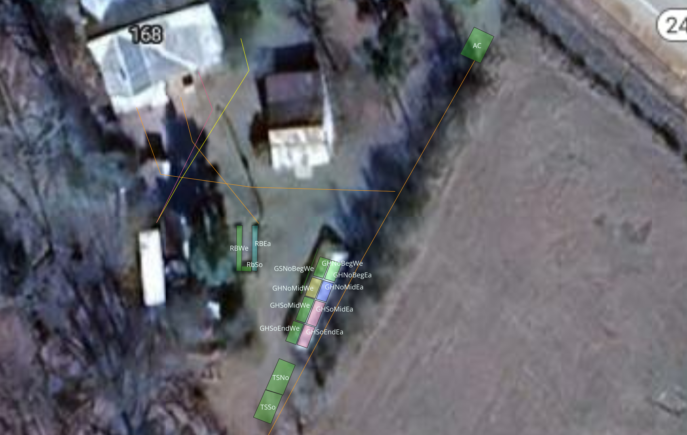

# Crops
## By Type

### Plants
#### Roots & Tubers
Garlic
Beets
Carrots
Onions

#### Fruiting (Require Pollination)
Tomatoes
Cucumbers
Eggplant
Peppers
Watermelons

Sweet Corn

Spaghetti Squash
Summer Squash
Acorn Squash
Butternut Squash

Scarlet Runner Beans
Cowpeas
#### Leafy Greens (Heavy Feeders)
Collards
Kale
Cabbage
Broccoli
Chard

#### Leafy Greens (Light Feeders)
Lettuce
Spinach
### Bushes
Raspberry
Elderberry
Blueberry
Blackberry

### Trees
Turkey Figs
Japanese Plum
Asian Pear
Pineapple Pear
Kiefer Pear
Chickasaw Plum
Lemon Trees
Banana Trees


## By Plot
Subplot Naming Key: 
`{AB}` = Abbreviation, derived from its familiar name / title, All Caps
`{Di}` = Cardinal Directions as two letters, Capitalized, eg No / Ea / So / We
`{Pos}` = Position, standing at the northern most end (the end we typically approach from) in three letters, Capitalizer, eg Beg / Mid / End = Beginning / Middle / End
Name Legend will appear as follows to indicate how the name for that plot is characterized. For example:`{AB}{Di}{Pos}{Di}`
All dimensions in feet, with the first value running North to South and the second value running East to West.

### Three Sisters
#### Subplots
Legend: `{AB}{Di}`

| Subplot | Dimensions (ft) |
|:---|:---|
| TSSo | 16.5 x 10 |
| TSNo | 16.5 x 10 |

##### Corn
Sweet Corn

##### Squash
Spaghetti Squash
Summer Squash
Acorn Squash
Butternut Squash

##### Legumes
Scarlet Runner Beans
Cowpeas

### Greenhouse
#### Subplots
Legend: `{AB}{Di}{Pos}{Di}`

| Subplot | Dimensions (ft) |
|:---|:---|
| GHSoEndEa | 11 x 5.5 |
| GHSoEndWe | 11 x 5.5 |
| GHSoMidEa | 13 x 5.5 |
| GHSoMidWe | 13 x 5.5 |
| GHNoMidEa | 10 x 5.5 |
| GHNoMidWe | 10 x 5.5 |
| GHNoBegEa | 10 x 5.5 |
| GHNoBegWe | 10 x 5.5 |

##### Roots & Tubers
Garlic
Beets
Carrots
Onions
Sweet Potato

##### Leafy Greens (Heavy Feeders)
Collards
Kale
Cabbage
Broccoli
Chard

##### Leafy Greens (Light Feeders)
Lettuce
Spinach

### Greenhouse Side
#### Subplots
Legend: `{AB}{Di}{Pos}{Di}`

| Subplot | Dimensions (ft) |
|:---|:---|
| GSNoBegWe | 20 x 1 |

Watermelons

### Raised Beds
#### Subplots
Legend: `{AB}{Di}`

| Subplot | Dimensions (ft) |
| :------ | :-------------- |
| RBEa    | 23 x 3          |
| RBSo    | 3 x 5           |
| RBWe    | 23 x 3          |
|         |                 |
#### Fruiting
Tomatoes
Cucumbers
Eggplant
Peppers
Cucumber


### Acidic
#### Subplots
Legend: `{AB}`

| Subplot | Dimensions (ft) |
| :------ | :-------------- |
| AC      | 15 x 11         |
#### Bushes
Raspberry
Elderberry

# Plan
## JADAM

JADAM is an ultra-low-cost, self-reliant organic farming system developed in South Korea by chemist and agriculturist Youngsang Cho. The name is an abbreviation of the Korean phrase _Jayeon-ul Damun Saramdeul_, which translates to "people who resemble nature." In the context of permaculture, JADAM serves as a powerful practical toolkit that perfectly aligns with permaculture's core design principles—specifically *"Produce No Waste,"* *"Use & Value Renewable Resources,"* and *"Obtain a Yield."* [1](https://www.youtube.com/watch?v=570b5aUQNSM&t=235), [2](https://permies.com/t/72060/JADAM-method-farming), [3](https://www.harmonia.institute/what-is-jadam-organic-farming-a-complete-guide-to-ultra-low-cost-regenerative-agriculture/)

While it evolved out of Korean Natural Farming (KNF), JADAM intentionally strips away complex, expensive, and commercialized inputs (like brown sugar or specialized imports). Instead, it teaches growers how to be entirely self-sufficient by creating potent biological amendments using nothing but local wild resources, crop residues, and water. [1](https://worldpermacultureassociation.com/liquid-fertilizers-how-to-make-them/), [2](https://www.youtube.com/watch?v=570b5aUQNSM&t=235), [3](https://www.harmonia.institute/what-is-jadam-organic-farming-a-complete-guide-to-ultra-low-cost-regenerative-agriculture/)

### Core Concept: The SESE Principles

JADAM operates under a framework known as **SESE**: **S**imple, **E**asy, **S**cientific, and **E**ffective. Its goal is to return technological sovereignty to the farmer so that anyone can manage thousands of acres—or a backyard food forest—for next to no money. [1](https://en.jadam.kr/com/com-1.html), [2](https://www.youtube.com/watch?v=570b5aUQNSM&t=235)

### The 4 Major JADAM Inputs Used in Permaculture

Permaculturists frequently integrate JADAM recipes into their soil-building and pest-management systems because they are decentralized and utilize local "waste" streams:

- **JADAM Microorganism Solution (JMS):** Considered the backbone of the system. Instead of buying commercial bio-inoculants, you harvest a handful of rich leaf mold soil from a nearby healthy forest. You ferment these indigenous microorganisms (IMOs) in a bucket of water using boiled potatoes (as a carbohydrate food source) and sea salt. It breeds billions of native microbes to drench into your soil, rapidly improving soil structure and root depth. [1](https://www.youtube.com/watch?v=6-CfEKPo6xY&t=53), [2](https://www.youtube.com/shorts/3a2_t2F76xE), [3](https://www.homegrowncoop.org/solutions/how-to-start-jadam-organic-farming-low-cost-steps-for-sustainable-agriculture/)
- **JADAM Liquid Fertilizer (JLF):** A "like-for-like" nutrient cycle. You put wild grasses, crop residues, weeds, or food waste into a barrel, fill it with water, and let it undergo a continuous anaerobic fermentation. This creates a completely free, highly bio-available liquid fertilizer that mirrors how nutrients recycle on a forest floor. [1](https://www.youtube.com/watch?v=MDzvIN9AEH4&t=481), [2](https://www.youtube.com/watch?v=570b5aUQNSM&t=235), [3](https://worldpermacultureassociation.com/liquid-fertilizers-how-to-make-them/), [4](https://www.facebook.com/groups/permaculturenz/posts/2521228108146368/)
- **JADAM Wetting Agent (JWA):** A natural, eco-friendly liquid surfactant made from canola/castor oil and potassium hydroxide. It breaks the surface tension of water, allowing natural foliar sprays to smoothly coat and stick to plant leaves without washing away. [1](https://www.youtube.com/watch?v=_63xa8bEUzM&t=144), [2](https://kimchime.com.au/blog-home/organic-farming-jadam/?srsltid=AYCX9vLWizFbRSW6gMn4KH7Ea4syqYZFPZMR0jvOUgPVFgevG0Evs5jD), [3](https://www.harmonia.institute/what-is-jadam-organic-farming-a-complete-guide-to-ultra-low-cost-regenerative-agriculture/)
- **JADAM Sulfur (JS) & Herbal Solutions (JHS):** Used for natural pest and disease control. By combining JWA with melted raw sulfur or boiled highly-potent local herbs (like garlic or wild mint), growers create powerful fungicides and pesticides that comply with strict organic regulations. [1](https://www.youtube.com/watch?v=5EY6lOfICbw&t=148), [2](https://en.jadam.kr/com/com-1.html), [3](https://www.youtube.com/watch?v=_63xa8bEUzM&t=144), [4](https://www.youtube.com/watch?v=6-CfEKPo6xY&t=53), [5](https://www.harmonia.institute/what-is-jadam-organic-farming-a-complete-guide-to-ultra-low-cost-regenerative-agriculture/)

### How JADAM Complements Permaculture Philosophy

- **Radical Self-Reliance:** Permaculture emphasizes localizing supply chains. JADAM ensures you never have to purchase commercial organic fertilizers, bagged compost, or bottled pesticides again. [1](https://www.linkedin.com/posts/jonathanwells369_jadam-stands-for-jayonul-damun-saramdeul-activity-7332799302659883008-Znw-), [2](https://en.jadam.kr/com/com-1.html)
- **Accepting Anaerobic Processes:** While traditional organic farming and permaculture often over-index on highly aerated compost teas, JADAM values anaerobic putrefaction. It recognizes that anaerobic microbes are natural, powerful decomposers crucial to balanced living ecosystems. [1](https://www.facebook.com/groups/permaculturenz/posts/2521228108146368/), [2](https://www.youtube.com/watch?v=MDzvIN9AEH4&t=481)
- **Open-Source Knowledge:** True to permaculture's third ethic of "Fair Share," JADAM’s formulations are explicitly unpatented and open-source, intended to be freely modified and shared globally. [1](https://permies.com/t/72060/JADAM-method-farming), [2](https://worldpermacultureassociation.com/liquid-fertilizers-how-to-make-them/)

If you are looking to scale up a permaculture design or food forest without spending a fortune on external store-bought inputs, JADAM is often the missing operational manual that makes it financially viable. [1](https://www.youtube.com/watch?v=YQnoWWw6k0Y), [2](https://www.harmonia.institute/what-is-jadam-organic-farming-a-complete-guide-to-ultra-low-cost-regenerative-agriculture/)
### Farm Profile & Site Diagnostic

- **Location & Climate:** USDA Zone 8b, Southeast Georgia (below the Fall Line). Hot, humid, extended growing season; mild winters with erratic warm snaps; proximity to coastal/marsh humidity.
    
- **Native Soil Profile:** 24 inches of sandy loam over dense subsoil clay. High drainage and aeration in the topsoil with high leaching susceptibility (especially for borates, nitrates, and potassium); dense clay subsoil acts as an impermeable chemical and root barrier that can perch water during excessive rainfall.
    
- **Compost Infrastructure:** Five 3 ft × 5 ft × 4 ft enclosed bays processing horse stable muckings (manure, sawdust, wood chips) plus winter hay. High-carbon, fungal-dominant feedstock potential; produces substantial bulk organic matter.
    - **Locally Sourced Mulches & Plants:** Abundant local pine straw; wild/foraged stands of comfrey and stinging nettle; native forest leaf mold (IMO microbial source); unrefined sea salt / coastal mineral access.
    
- **Hydrology & Irrigation Infrastructure:**
    
    - _Greenhouse:_ Automated overhead misting (seasonal intervals: daily in summer, alternate days in fall, every 4 days in winter). High humidity, gentle water delivery.
        
    - _Three Sisters:_ Open plot with subsurface drip lines (4–6 inches deep, 2ft apart) embedded within buried woody mulch bands beneath the crop rows.
        
    - _Raised Beds:_ Dual-hydrology system in RBEa and RBWe (the longer beds) featuring a subterranean graywater wicking basin below 24 inches of topsoil, paired with natural rainfall.
        
    - _Acidic Plot:_ Ambient precipitation supported by dedicated 10-minute daily drip stakes placed 6–12 inches from cane/shrub crowns.
        
- **Operational Mandate:** Permaculture design principles with JADAM self-reliance additions:
    - Minimize Waste Products
    - Use & Value Renewable Resources (closed-loop reliance on farm-sourced biology, dynamic accumulators, and wild microorganisms)
    - Obtain a Yield
    - Low-carbon footprint
    - SESE Framework: Simple, Easy, Scientific, and Effective
    - Zero-to-minimal store-bought inputs: replace recurring commercial fertilizers, inoculants, and pest sprays with farm-made JADAM preparations (JMS, JLF, JWA, JS)
    - Minimize plastic for non-infrastructure purposes to the extent possible
    

### Critical Operational Adjustments to Your Infrastructure

Before addressing the plots, your site details require four crucial technical interventions:

#### 1. Graywater Salinity & Boron Dynamics in Raised Beds

A subterranean wicking basin charged with household graywater creates two distinct chemical risks in a raised bed:

- **Sodium & Surfactants:** Household soaps, laundry wash, and cleaners often carry sodium salts and sulfates. In a bottom-up wicking system, water travels upward via capillary action, evaporates at the surface, and leaves salts behind. Over time, electrical conductivity (EC) spikes in the top 6 inches, causing salt burn on salt-sensitive Solanaceae (especially peppers and eggplants).
    
- **The Boron Trap:** Some detergents contain sodium borate or perborate. While boron is needed in trace amounts, a buildup will cause severe margin necrosis and plant death.
    
- **Intervention:** Ensure all household detergents are strictly potassium-based, plant-safe, and boron-free. Flush the beds with heavy top-watering once each spring to wash accumulated wick-salts back down past the primary root zones.
    

#### 2. Greenhouse Misting: Salt Accumulation & Disease Vector

- **Watering Frequency Calibration:** Winter misting every 4 days is often too wet for dormant greenhouse soil in humid coastal Georgia, yet daily summer misting risks constant leaf wetness. 

TODO: Determine frequency of misting for various crops based on the stage and seasonal conditions.

#### 3. Woody Mulch Nitrogen Immobilization in Three Sisters

Buried wood chips/sawdust (4–6 inches deep) next to subsurface drip lines will drive intense fungal and bacterial decomposition right at your irrigation zone. Microorganisms require a Carbon-to-Nitrogen (C:N) ratio of roughly 24:1. High-carbon wood materials (C:N 100:1 to 400:1) will cause soil microbes to pull all free plant-available nitrogen (NO_3^- and NH_4^+) out of the surrounding soil solution.

- While the beans fix their own nitrogen once nodulated, corn is an extreme nitrogen feeder and will rapidly stunt, yellow, and fail if its nodal roots hit a nitrogen-starved, wood-dominated subsurface layer.
    
- **Intervention:** Inoculate this subsurface wood layer directly with **JADAM Microorganism Solution (JMS)** blended with high-nitrogen **JADAM Liquid Fertilizer (JLF)** (made from fresh grass clippings, stinging nettle, or farm urine). The native microbes rapidly digest the wood without robbing available nitrogen from the corn roots.
    

#### 4. The 10-Minute Drip on Acidic Plot

A daily 10-minute drip run wets only a tiny bulb of sandy loam directly under the emitter, discouraging root expansion into the wider bed, while keeping the surface root crowns constantly damp (inviting _Phytophthora_ root rot in raspberries).

- **Intervention:** Shift from 10 minutes daily to **30–45 minutes once or twice a week**. This forces water 12–18 inches deep, matching the native 2-foot topsoil profile and training the berries to send deep, resilient anchor roots down to the moisture-retentive clay transition zone.
    

### Closed-Loop Biological Strategy: Replacing Store-Bought Inputs with JADAM

Rather than relying on ongoing purchases of commercial organic inputs or bulky mineral sacks, JADAM utilizes locally harvested wild inputs and simple water fermentations:

1. **Microbial Diversity (Replaces Commercial Inoculants & Mycorrhizae):**
   - **JMS (JADAM Microorganism Solution):** Harvest a handful of rich indigenous leaf mold soil from a healthy local forest. Ferment in water with boiled potatoes (starches) and a pinch of unrefined sea salt for 24–72 hours until vigorous foam peaks. Apply as a soil drench to wake up biological nutrient cycling across all beds.

2. **Full-Spectrum Trace Minerals (Replaces Basalt Rock Dust & Solubor / Borax):**
   - **Natural Sea Salt in JMS:** Unrefined natural sea salt provides full-spectrum ocean minerals (magnesium, zinc, iron, boron, manganese, selenium) in natural biological ratios. Delivered regularly via JMS drenching, it supplies all required trace elements for pennies.

3. **Complete N-P-K & Calcium (Replaces Soft Rock Phosphate, Bone Meal & Chemical Feeds):**
   - **JLF (JADAM Liquid Fertilizer):** Anaerobic barrel ferments of site-harvested comfrey, stinging nettle, dynamic weeds, charred bone, and eggshell scrap. Water-soluble, zero-cost, and immediately available to plant roots without synthetic processing.

4. **Natural Disease & Pest Control (Replaces Commercial Fungicides & Insecticides):**
   - **JWA (JADAM Wetting Agent):** Biodegradable natural surfactant made from canola oil, KOH, and soft water.
   - **JS (JADAM Sulfur) & JHS (Herbal Solutions):** Homemade melted raw sulfur and boiled herb extracts (wild mint, garlic, horsetail). Mixed with JWA, these control powdery mildew, downy mildew, and soft-bodied pests without breaking organic standards.

*(Note: If bulk agricultural sacks of basalt dust or gypsum are already on hand, incorporate them into the 5-bay compost piles as a one-time mineral charge, but rely on JADAM liquid ferments for ongoing seasonal nutrition).*


### Adapted Plan by Plot

#### 1. Three Sisters Plot (Sandy Loam over Clay, Subsurface Woody Drip)

- **The Dynamic:** Sweet Corn, Squash varieties, Scarlet Runner Beans, Cowpeas.
    
- **Nutrient Adjustments:**
    
    - The sandy loam leaches potassium quickly; your buried wood risks locking up nitrogen. Cowpeas will adapt quickly to the heat, but Runner Beans often drop blossoms when Georgia 8b summer temperatures exceed 85°F–90°F. (Favor cowpeas in the hottest months).
        
- **Soil & Mulch Actions:**
    
    - **Compost Charge & JMS Inoculation:** Work finished horse manure compost into planting hills. Drench planting hills at sowing with **JMS** to rapidly colonize native microbes along the root zone and kickstart decomposition of the buried wood.
        
    - **Trace Minerals & Potassium (Replaces Basalt Dust Purchases):** Drench with sea-salt-charged JMS and a 1:30 dilution of **Comfrey JLF** to supply zinc, boron, and bioavailable potassium for corn stalk rigidity and squash fruiting.
        
    - **Mulch Layer:** Surface-dress around the corn and squash with **pine straw**. Pine straw moderates high summer soil temperatures in Zone 8b, suppresses weed flushes, and does not rob surface nitrogen like raw wood shavings do.
        

#### 2. Greenhouse (Dark, 3-Year Matured Soil, Transitioning from Mist)

- **The Dynamic:** Garlic, Beets, Carrots, Onions | Brassicas, Chard | Lettuce, Spinach.
    
- **Nutrient Adjustments:**
    
    - Beets and carrots demand high Boron; alliums and brassicas demand substantial Sulfur.
        
    - Because this soil is protected from rain, do not apply heavy rock dusts annually—they will accumulate. Rely on your site-harvested dynamic accumulator liquids.
        
- **Soil & Mulch Actions:**
    
    - **Sulfur & Boron Delivery (Replaces Gypsum Dust):** Drench the root beds (beets, carrots, alliums) early in the cycle with **Stinging Nettle JLF** (diluted 1:20 to 1:50) and a light foliar spray of **JADAM Sulfur (JS)** with **JWA**. This supplies plant-chelated boron, iron, and sulfur for allicin and glucosinolate production without altering soil pH or adding insoluble mineral residue to greenhouse beds.
        
    - **Mulch:** Use aged pine straw in thin layers between rows of greens to keep splashed soil off leaves and inhibit fungal spores.
        

#### 3. Raised Beds (Wicking Sub-Basin, Graywater, Precipitation)

- **The Dynamic:** Tomatoes, Cucumbers, Eggplant, Peppers.
    
- **Nutrient Adjustments:**
    
    - The upward moisture wicking delivers continuous base water, while the open top receives torrential summer rain. This creates rapid transpiration; heavy fruit set requires massive Potassium (K) and constant Calcium (Ca) to avoid Blossom End Rot.
        
- **Soil & Mulch Actions:**
    
    - **The Comfrey Vector & JLF:** In addition to laying chopped comfrey leaves around stalks, brew a dedicated barrel of **Comfrey & Bone/Shell JLF**. Water tomatoes and peppers bi-weekly with diluted Comfrey JLF to deliver water-soluble potassium and calcium directly to the feeder roots.
        
    - **Foliar Silicon & Mildew Protection (Replaces Commercial Sprays):** Combine horsetail (_Equisetum_) or stinging nettle JLF with **JADAM Wetting Agent (JWA)** and low-dose **JADAM Sulfur (JS)**. Spray early morning on cucumber and tomato leaves to reinforce cell walls with natural silica and prevent downy and powdery mildew in coastal Georgia humidity.
        

#### 4. Acidic Plot (Perennial Berries, Ambient Rain, Corrected Drip)

- **The Dynamic:** Raspberry, Elderberry.
    
- **Nutrient Adjustments:**
    
    - Standard floricane raspberries struggle with the extreme heat and humidity of Georgia Zone 8b unless provided afternoon shade and acidic, high-drainage soils. Elderberries thrive naturally in native marsh-adjacent soils.
        
    - Target pH: 5.5 – 6.2. Avoid all horse manure compost here; horse compost containing stable limestone or neutral muck will drive the pH up to 7.0, causing severe iron chlorosis.
        
- **Soil & Mulch Actions:**
    
    - **Acidic Forest Leaf Mold JMS:** Brew JMS using leaf mold gathered specifically from **mature pine and oak stands** to inoculate the berry beds with native acid-tolerant, ericoid mycorrhizal fungi. This maximizes iron and manganese availability biologically without commercial acidifiers or synthetic chelates.
        
    - **Mulch Strategy:** Blanket this bed with a thick 4-to-6-inch layer of **pure pine straw** combined with decomposing oak leaves or pine bark fines. As pine needles decompose in the humid heat, they release organic acids and maintain an active fungal ecosystem that keeps iron and manganese soluble.
        
    - **Irrigation Recalibration:** Change the drip stakes to run for 30–45 minutes twice a week rather than 10 minutes daily. This encourages roots to head downward through the 2-foot topsoil zone toward the moisture-retentive clay subsoil.
        

### Farm Resource Flow Matrix

```
[Forest & Wild Lands]
   │
   ├─► Forest Leaf Mold ─────► JADAM JMS (Brewed w/ Sea Salt & Potato) ──► Universal Soil & Compost Inoculation
   ├─► Comfrey & Nettles ────► JLF Anaerobic Barrel Ferment ────────────► High-K / High-N Liquid Fertigation
   └─► Pine Straw ───────────► Acidic Surface Mulch ────────────────────► Berry Beds & Three Sisters
   
[Horse Stables]
   │
   └─► Manure, Shavings ─────► 5-Bay Composting (Activated w/ JMS) ─────► Main Base Compost (Three Sisters)
                                 (Bulk Organic Matter)
                                 
[Zero-Cost Pest & Foliar Defense]
   │
   ├─► JADAM Wetting Agent (JWA) ──┐
   ├─► JADAM Sulfur (JS) ──────────┼─► Foliar Sprays ───────────────────► Powdery/Downy Mildew & Pest Control
   └─► Horsetail / Herbal JHS ─────┘
```


## Crop potentials

Vermiculture Worm casings (compost)
Wasabi (swamp)
